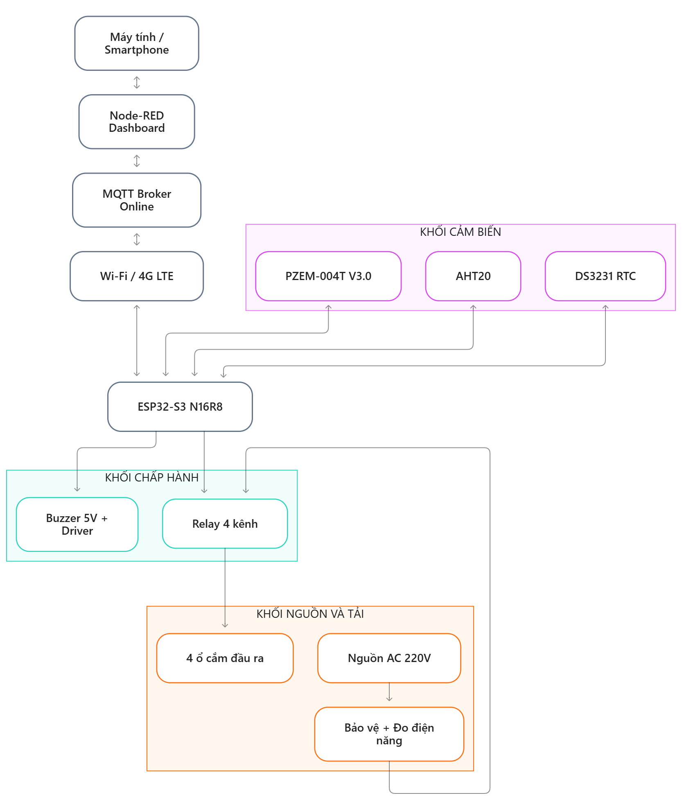

# SMART POWER GUARD

### Hệ thống ổ cắm thông minh giám sát điện năng, quản lý tải và bảo vệ thiết bị sử dụng IoT

---

## 1. Giới thiệu đề tài

SMART POWER GUARD là hệ thống ổ cắm điện thông minh ứng dụng công nghệ IoT, sử dụng vi điều khiển ESP32-S3 làm bộ điều khiển trung tâm.

Hệ thống hướng đến khả năng giám sát điện năng tiêu thụ, theo dõi nhiệt độ và độ ẩm, điều khiển thiết bị điện từ xa, lập lịch hoạt động và cảnh báo các tình trạng bất thường.

Dữ liệu được trao đổi thông qua giao thức MQTT và hiển thị trên Node-RED Dashboard, cho phép người dùng theo dõi và điều khiển hệ thống từ máy tính hoặc điện thoại thông minh.

Phiên bản thử nghiệm ban đầu sử dụng một ổ cắm đầu ra. Kiến trúc được thiết kế theo hướng mở rộng tối đa bốn ổ cắm độc lập.

## 2. Đặt vấn đề

Trong cuộc sống hiện nay, các thiết bị điện như máy tính, laptop, điện thoại và các thiết bị điện tử thường được sử dụng đồng thời.

Tuy nhiên, người dùng còn gặp một số khó khăn:

- Khó theo dõi lượng điện năng tiêu thụ.
- Không thể điều khiển ổ cắm từ xa.
- Khó phát hiện tình trạng tiêu thụ điện bất thường.
- Không theo dõi được nhiệt độ bên trong hộp ổ cắm.
- Thiếu chức năng lập lịch và tự động ngắt nguồn.

Xuất phát từ những nhu cầu thực tế trên, đề tài SMART POWER GUARD được đề xuất nhằm phát triển một hệ thống ổ cắm thông minh có khả năng giám sát, quản lý và điều khiển thiết bị điện thông qua Internet.

## 3. Mục tiêu đề tài

- Thiết kế hệ thống sử dụng ESP32-S3.
- Đo điện áp, dòng điện, công suất và điện năng tiêu thụ.
- Giám sát nhiệt độ và độ ẩm.
- Điều khiển ổ cắm thông qua Relay.
- Cảnh báo khi phát hiện quá tải hoặc quá nhiệt.
- Thiết lập lịch bật/tắt thông qua đồng hồ thời gian thực.
- Trao đổi dữ liệu bằng MQTT.
- Xây dựng giao diện Node-RED Dashboard.
- Nghiên cứu kết nối dự phòng Wi-Fi và 4G LTE.

## 4. Sơ đồ khối hệ thống

Sơ đồ khối tổng thể dự kiến:

Hệ thống gồm các khối chính:

1. Khối giám sát và điều khiển.
2. Khối truyền thông.
3. Khối điều khiển trung tâm.
4. Khối cảm biến.
5. Khối chấp hành.
6. Khối nguồn và tải.

Phiên bản đầu tiên sử dụng một ổ cắm đầu ra. Ba kênh Relay còn lại được dự phòng cho khả năng mở rộng.

## 5. Phần cứng dự kiến

| Linh kiện | Chức năng |
|---|---|
| ESP32-S3 N16R8 | Điều khiển trung tâm |
| PZEM-004T V3.0 | Đo điện năng |
| AHT20 | Đo nhiệt độ và độ ẩm |
| DS3231 RTC | Đồng hồ thời gian thực |
| Relay 4 kênh | Điều khiển ổ cắm |
| Buzzer 5V | Cảnh báo âm thanh |
| Driver Buzzer | Khuếch đại điều khiển |
| Module SIM 4G LTE | Kết nối dự phòng |
| Nguồn AC-DC cách ly | Cấp nguồn cho mạch |

## 6. Chức năng dự kiến

### 6.1. Giám sát điện năng
Đo điện áp, dòng điện, công suất và điện năng tiêu thụ thông qua PZEM-004T V3.0.

### 6.2. Giám sát môi trường
Theo dõi nhiệt độ và độ ẩm bên trong hộp ổ cắm bằng AHT20.

### 6.3. Điều khiển ổ cắm
Điều khiển đóng/ngắt nguồn điện thông qua module Relay và giao diện Node-RED.

### 6.4. Cảnh báo an toàn
Phát hiện các tình trạng quá tải hoặc quá nhiệt, phát cảnh báo âm thanh và thực hiện ngắt tải theo ngưỡng bảo vệ.

### 6.5. Lập lịch hoạt động
Sử dụng DS3231 để duy trì thời gian và thực hiện lịch bật/tắt ngay cả khi mất kết nối Internet.

### 6.6. Kết nối dự phòng
Nghiên cứu chuyển đổi giữa Wi-Fi và 4G LTE để duy trì kết nối với MQTT Broker.

## 7. Công nghệ sử dụng

- ESP32-S3.
- Arduino Framework.
- VS Code và PlatformIO.
- MQTT.
- MQTT Broker Online.
- Node-RED Dashboard.
- Giao tiếp UART và I2C.
- GitHub.

## 8. Nguyên lý hoạt động

Các cảm biến thu thập dữ liệu điện năng và môi trường, sau đó gửi về ESP32-S3 để xử lý.

ESP32-S3 thực hiện kiểm tra các ngưỡng cảnh báo, điều khiển Relay và Buzzer. Dữ liệu được gửi qua MQTT Broker đến Node-RED Dashboard để hiển thị.

Người dùng có thể gửi lệnh điều khiển từ Dashboard. Khi mất Internet, các chức năng điều khiển và bảo vệ cục bộ vẫn được duy trì.

## 9. Phạm vi thực hiện

| Phiên bản | Nội dung |
|---|---|
| 1 | Một ổ cắm, điều khiển Relay và đo điện năng |
| 2 | Giám sát nhiệt độ và cảnh báo |
| 3 | MQTT, Node-RED và lập lịch RTC |
| 4 | Mở rộng bốn ổ cắm và kết nối 4G |

## 10. Yêu cầu an toàn

Do hệ thống sử dụng điện lưới 220VAC, thiết kế cần có cầu chì, thiết bị bảo vệ quá dòng phù hợp, cách điện giữa vùng điện áp thấp và vùng điện lưới, nguồn AC-DC cách ly và vỏ bảo vệ chống tiếp xúc trực tiếp.

Các chức năng bảo vệ bằng phần mềm không thay thế thiết bị bảo vệ điện độc lập.

## 11. Tài liệu tham khảo

1. ESP32-S3: https://docs.espressif.com/projects/esp-idf/en/stable/esp32s3/
2. PlatformIO: https://docs.platformio.org/
3. Node-RED: https://nodered.org/docs/
4. MQTT: https://mqtt.org/
5. https://www.studocu.vn/vn/document/truong-dai-hoc-cong-nghiep-ha-noi/trang-bi-dien/thiet-ke-o-cam-dien-thong-minh-dieu-khien-qua-wifi/53039093
6. https://mattervn.com/o-cam-thong-minh-wifi/

